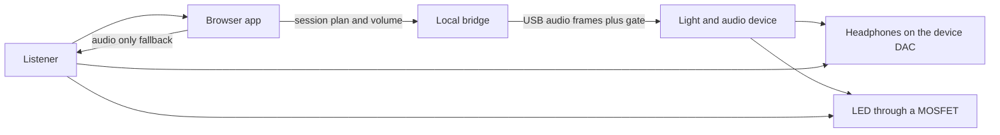

# Architecture

## System context



The browser is a controller and, in the fallback path, a player. It is not
the sample clock for a lamp. The bridge is optional when the MCU itself
synthesizes the session (path E1). The bridge is required for path E2 when
the browser must not hold the USB device.

## Paths

| Path | Who renders PCM | Who toggles the pin | Sync class | When to use it |
| --- | --- | --- | --- | --- |
| A. Browser only | Web Audio | nobody | audio only | No device, or the user declined the light |
| E1. Device synth | MCU | MCU, same callback | exact | The headphones are on the MCU DAC. The browser sent a plan |
| E2. USB playback | Bridge or host | MCU, from gate bits in the USB frame | exact | The host must render, and the headphones are still on the MCU DAC |
| B. Split lamp | Host or MCU audio | A second MCU with a PLL | bounded | A lamp that cannot hold a shared timeline |
| N. Scheduled lamps | Conductor (CYD or bridge) | Other badges, at a TAI appointment | scheduled | Multi-room lamps. See [14-network-time.md](14-network-time.md) |

Path A is Tranche 2. Path E1 is Tranche 4 and is the preferred exact design.
On the hardware we have, E1 is the CYD badge: internal mono DAC and GPIO
from one sample counter ([13-cyd-badge.md](13-cyd-badge.md)). Path E2 is
Tranche 3 and exists so a host-side renderer can still be exact. Path N is
the multi-badge design: lamps keep appointments on a shared clock. Path B
is only for a follower that cannot run that clock. Path B and path N are
Tranche 5. PTP shows up there, on nodes that can timestamp Ethernet, and
in the software servo the CYD runs instead.

Headphones plugged into the laptop, with the MCU only watching USB serial,
are path B even if the serial link is short. The OS mixer and the serial
driver are different clocks.

## Components and owners

| Component | Process | Owns | Must not own |
| --- | --- | --- | --- |
| Stimulus kernel | library, no process | sample math, gate function | devices, UI, network |
| Web app | browser | plan editing, consent, audio-only playback, display of device status | the USB handle, when a bridge is running |
| Bridge | localhost native process | USB handle, token, E2 frame pacing, optional host audio if explicitly configured | a public bind address |
| Firmware | MCU | pin electrical level, DAC, watchdog, E1 synthesis, E2 frame playout | user-interface copy, SPL policy beyond the peak cap |

One owner per hardware resource. Two owners of the USB device is a defect.

## Trust boundary

The MCU treats every host as untrusted.

- Plans that fail the schema or REQ-KERNEL-005 are rejected.
- `photosensitivity_ack` must be true before a light-enabled plan can arm.
  The firmware stores that flag and returns it in status. A host can lie.
  That is acceptable for this research tool and is not a safety proof. The
  electrical limits (duty cap, watchdog, off-on-fault) do not trust the host
  to keep sending “off”.
- Frames with a bad CRC are dropped. Five bad frames in a row during a run
  force a fault and the pin off.
- The bridge token stops other local users from opening the socket only as
  well as the OS user account allows. Bind to loopback anyway.

## Data that cross the boundary

Control, rare and reliable:

- `gamma.session_plan.v1` JSON
- arm, start, stop, clear-fault
- status at 5 Hz while running, and on every state change

Media, only on path E2, every 1 ms:

- 48 stereo or mono int16 samples
- 48 gate bits
- a monotonically increasing frame index

Path E1 sends no media. The plan is the media.

Path B sends a sync frame at 10 Hz. It does not send PCM. Details are in
[05-time-sync.md](05-time-sync.md) and [06-protocols.md](06-protocols.md).

## Clock domains

| Clock | Where it appears | Exact-mode role |
| --- | --- | --- |
| Sample index | kernel | the only timeline the gate and the PCM share |
| MCU audio MCLK / I2S bit clock | DAC and GPIO timer | the physical clock in E1 and E2 |
| USB frame clock | full-speed 1 ms frames | transport pacing in E2. The device is the audio clock master |
| `AudioContext.currentTime` | browser | path A only |
| `performance.now` / `Date.now` | browser UI labels | display. Never used to place a burst |
| BLE connection events | control radio | commands. Interval is typically 7.5–50 ms |
| Wi-Fi / WebSocket | control | commands. Jitter is milliseconds to tens of milliseconds |
| IEEE 1588 | optional Ethernet between panels | path B panels only, and only after a grandmaster that is the audio device |

## Failure behavior

Every failure in this table ends with the LED off.

| Event | Detection | Response |
| --- | --- | --- |
| USB frames stop | no complete frame for 5 ms in E2 | fault, silence the DAC, pin off |
| Render task late | E1 callback misses a block | fault, pin off, do not “catch up” by skipping the gate relative to audio |
| Host disconnect | USB or socket drop | pin off within 5 ms of the stack noticing |
| Plan hash mismatch on a sync frame | path B | ignore the frame, hold last good correction for at most 250 ms, then pin off |
| Duty cap or schema failure | before arm | stay idle, pin off, return an error string |

Catching up by emitting extra flashes is forbidden. A late renderer stops.

## Extension points

Add a protocol by adding an enum value, a pure renderer, and a vector. Do
not branch on protocol strings inside the firmware USB task. The firmware
calls the kernel.

Add a transport by implementing the control messages in
[06-protocols.md](06-protocols.md). A transport does not get its own
definition of “sample 0”.

Add a device by implementing status `sync_mode` honestly. A device that
cannot meet REQ-SYNC-001 reports `bounded` or `none`.

## Repository the later tranches create

```
packages/stimulus-kernel/    TypeScript, pure, Tranche 1
firmware/esp32/              ESP-IDF, Tranche 4, may vendor a C port of the kernel
tools/bridge/                Python or Rust, Tranche 3
apps/web/                    Tranche 2
```

The kernel’s public API is the shape in
[03-stimulus-spec.md](03-stimulus-spec.md). The C port and the TypeScript
port are peers. Neither is allowed to “fix” a vector without a docs change.
