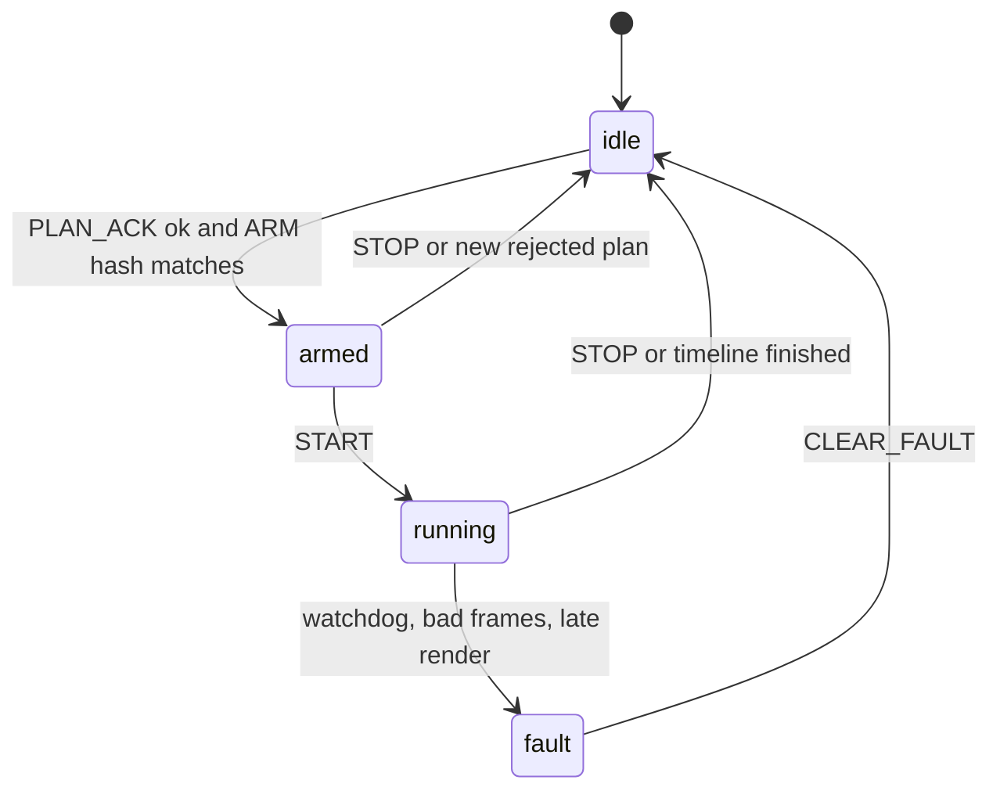

# Firmware specification

Target for the first board: the Freenove ESP32 CYD badge in
[13-cyd-badge.md](13-cyd-badge.md). ESP-IDF 5.5, mono 48 kHz, 8-bit
`dac_continuous` on GPIO26. The lamp GPIO and the DAC DMA share the sample
counter that the render task owns. An external I2S DAC is a later sink
behind the same render task. It is not required to start, and the internal
DAC is not driven by the I2S peripheral.

Another MCU is allowed when it can implement the same state machine and the
same kernel results. Exact mode still means one sample clock for the audio
samples and the lamp.

The LED current, the MOSFET, and the diffuser are outside this spec. The pin
contract is not.

## Pin contract

| Item | Value |
| --- | --- |
| Function | one digital output |
| Idle level | electrical off |
| `active_high` | high means LED on, for a low-side N-channel MOSFET |
| `active_low` | low means LED on, for an inverted driver |
| Fault, stop, brownout, watchdog, unconfigured boot | electrical off, before the scheduler runs if the silicon allows it |
| Toggle rate | one edge pair per burst, 40 Hz, or the 50% visual pattern. Never the 10 kHz carrier |
| Boot | the pin is off through USB enumeration and Wi-Fi association |

Configure the pad as an output at the off level in the earliest board init,
before USB or the audio task starts. A pull-down on an active-high driver is
the hardware owner’s responsibility; firmware still drives the level.

## State machine



`running` is the only state in which the pin may leave the off level, and
only on samples whose logical gate is 1.

ARM checks:

- hash matches the stored plan
- `photosensitivity_ack` is true when light is enabled
- expected duty ≤ `max_duty`
- sample rate is 48000 for this firmware revision
- capability bit for the requested path is set

START does not mean “toggle now”. It means “the next I2S block is sample 0”.

When the timeline ends, the firmware returns to `idle`, writes a final
STATUS, and leaves the pin off. It does not loop the session.

## E1 render task

On the CYD this task sits above Wi-Fi and LVGL. Block size 48 samples.
The write is `dac_continuous_write` of 8-bit mono converted from the
kernel’s float block. `dac_pipeline_samples` is the DMA depth actually
negotiated at open (the badge driver may shrink the buffer; measure the
value that was opened, do not assume 256). The lamp edge for a sample is
issued that many samples after the byte is queued, which is what the bench
then trims.

```
on dma_callback:
    if state != running:
        write silence
        pin_off()
        return
    block = kernel.render(48)
    write block.channels to i2s
    schedule block.gate delayed by dac_pipeline_samples
    if the callback was late:
        enter fault
```

“Late” means the DMA callback fired again before the previous render
finished, or the driver reports an underrun. The response is fault and pin
off. Do not drop gate bits to catch up while still playing audio. Silence
and darkness stay paired.

The C kernel is a port of the oracle. It keeps RNG and Kellet state inside
the session, reset on ARM using the procedure in
[03-stimulus-spec.md](03-stimulus-spec.md). It does not call `malloc` in the
callback. The plan is parsed in the control task.

`dac_pipeline_samples` is a named constant per board revision, set from the
calibration sheet, not a guessed “3 ms”.

## E2 playout

A bulk endpoint receives the fixed records from
[05-time-sync.md](05-time-sync.md). The audio task and the USB task
communicate through a two-block queue. If the queue under-runs, fault. If a
`frame_index` is not the previous index plus one, fault. Gate bits use the
same pipeline constant as E1.

The device is the USB audio clock master when an OS-facing speaker interface
exists. The vendor data interface is still the source of samples in v1, so
the host bridge paces those records to the device’s feedback endpoint or to
a simple start-of-frame counter. Tranche 3 picks one pacing method and
writes it down in the firmware README. Changing pacing is a firmware version
bump because it changes `dac_pipeline_samples`.

## Watchdog

A hardware watchdog resets the chip if the audio task fails to pet it for
100 ms. The reset pin state must come up off. A software deadline of 5 ms
with no E2 frame, or an E1 underrun, faults without waiting for the chip
reset.

On any fault the firmware:

1. Drives the pin off.
2. Stops I2S or writes silence.
3. Sets `state` to `fault` and `last_error` to a short stable code:
   `underrun`, `frame_gap`, `bad_crc`, `late_render`, `link_down`.
4. Notifies status.
5. Ignores START until CLEAR_FAULT.

## Control stack

USB CDC is the v1 control transport because it is the same cable as E2 and
it works from the bridge without a radio. BLE and Wi-Fi implement the same
frames, behind capability bits, in a later slice of Tranche 4. They must
not grow a second state machine.

Status is emitted on every transition and at 5 Hz while `running`. The JSON
matches `schemas/device-status.schema.json`.

## Logging on device

A ring of the last 32 faults (code, sample index, uptime) is enough. Do not
store session audio. Do not store a user identifier.

## What the firmware README must contain

The tranche that adds firmware also commits:

- IDF version and the exact `sdkconfig` flags that matter (USB, I2S, task
  priorities)
- the value of `dac_pipeline_samples` and the date of the scope capture
- how to flash
- the STOP-frame unit test and a host-side script that sends the example plan
  and checks STATUS

Until the scope capture exists, HELLO_ACK must not set the exact-mode
capability bits. The device can still be developed against the kernel
vectors in simulation.
